<p align="center">
  
  <br>
  <sub>Prevent keyboard sliding up and covering inputs on React Native iOS projects. Powered by IQKeyboardManager.</sub>
</p>

<p align="center">
  <b>React Native Keyboard Manager</b> prevents the iOS keyboard from sliding up and covering text inputs, bringing the battle-tested power of <a href="https://github.com/hackiftekhar/IQKeyboardManager">IQKeyboardManager</a> to React Native with zero boilerplate, native smoothness, and complete toolbar control.
</p>

<p align="center">
  <a href="LICENSE"></a>
  <a href="https://www.npmjs.com/package/react-native-keyboard-manager"></a>
  <a href="https://www.npmjs.com/package/react-native-keyboard-manager"></a>
  
  =0.60-61DAFB?style=flat-square&logo=react&logoColor=black" alt="React Native >= 0.60">
  
  <a href="https://github.com/douglasjunior/react-native-keyboard-manager/pulls"></a>
</p>

<p align="center">
  <a href="#-quick-start"><b>Quick Start</b></a> ·
  <a href="#-why-keyboard-manager">Why</a> ·
  <a href="#-screenshots">Screenshots</a> ·
  <a href="#-compatibility">Compatibility</a> ·
  <a href="#-installation">Installation</a> ·
  <a href="#post-install-ios-swift-setup">Post Install</a> ·
  <a href="#-usage">Usage</a> ·
  <a href="#-api-reference">API</a> ·
  <a href="#platform-notes--known-issues">Known Issues</a> ·
  <a href="#-contributing">Contributing</a>
</p>

---

> [!WARNING]
> ### ⚠️ DEPRECATION NOTICE: Maintenance Mode
>
> This library was created to address iOS-only keyboard issues (e.g., the keyboard covering inputs) by integrating **IQKeyboardManager**.
>
> With Android moving to edge-to-edge by default, similar "keyboard covering inputs" problems can now happen on Android as well. Because of that, maintaining a library that only targets iOS no longer makes sense.
>
> For this reason, this project is now in **maintenance mode**: bug fixes and small PRs are welcome, but no new features are planned.
>
> **Thank you for all the partnership and collaboration over these 9 years of this project's journey, it truly made a difference.** ❤️
>
> **Recommended alternatives:**
> - [KeyboardAvoidingView](https://reactnative.dev/docs/keyboardavoidingview) (React Native built-in)
> - An edge-to-edge approach with [react-native-keyboard-controller](https://github.com/kirillzyusko/react-native-keyboard-controller) (cross-platform)

---

## 💡 Why Keyboard Manager?

- ⚛️ **Zero UI boilerplate.** No need to manually wrap every view in nested avoiding views or calculate keyboard height offsets by hand.
- 🍎 **Powered by IQKeyboardManager.** Relies on the most mature, battle-tested native iOS keyboard framework.
- ⌨️ **Native input toolbar.** Provides **Done** button dismissal and active placeholder display, with opt-in previous (`<`) / next (`>`) navigation buttons.
- 👆 **Dismiss on touch outside.** Tap anywhere outside active text fields to dismiss the keyboard cleanly.
- 🎛️ **Fully customizable.** Adjust keyboard distances, colors, dark/light appearance modes, and toolbar behaviors with simple JS/TS calls.
- 🪟 **Modal-friendly.** Includes native `<PreviousNextView>` support to preserve field traversal even inside complex modals.
- 🧪 **Mock included.** Comes with a pre-configured Jest mock ready for testing suites.

## 📸 Screenshots

| Feature | Enabled (with Keyboard Manager) | Disabled (default iOS behavior) |
|---|:---:|:---:|
| **Inputs Lifted** |  |  |
| **Native Toolbar** |  | _Input covered beneath keyboard_ |

<p align="center">
  
  <br>
  <sub>Credits: <a href="https://github.com/hackiftekhar/IQKeyboardManager">IQKeyboardManager</a></sub>
</p>

## 📋 Compatibility

| React Native Version | Recommended Library Version |
|---|---|
| `RN >= 0.72.0` | `react-native-keyboard-manager@latest` |
| `RN 0.60.0 ... 0.71.x` | `react-native-keyboard-manager@6.5.11-2` |
| `RN 0.53.0 ... 0.59.10` | `react-native-keyboard-manager@4.0.13-12` |
| `RN 0.47.0 ... 0.52.2` | `react-native-keyboard-manager@4.0.13-5` |
| `RN 0.40.0 ... 0.46.4` | `react-native-keyboard-manager@4.0.13-1` |

## 🚀 Quick Start

```bash
# 1. Install dependency
yarn add react-native-keyboard-manager
# or: npm i -S react-native-keyboard-manager

# 2. Install native CocoaPods dependencies
cd ios && pod install
```

> [!NOTE]
> Because IQKeyboardManager is written in Swift, ensure Swift is enabled in your Xcode project (see [Post Install](#post-install-ios-swift-setup) for the required one-time bridging header setup).

```tsx
import { Platform } from 'react-native';
import KeyboardManager from 'react-native-keyboard-manager';

if (Platform.OS === 'ios') {
  KeyboardManager.setEnable(true);
  KeyboardManager.setEnableAutoToolbar(true);
  KeyboardManager.setToolbarDoneBarButtonItemText('Done');
  KeyboardManager.setToolbarPreviousNextButtonEnable(true);
  KeyboardManager.setShouldResignOnTouchOutside(true);
}
```

## 📦 Installation

### 1. Install JavaScript Package

Using yarn:
```bash
yarn add react-native-keyboard-manager
```

Using npm:
```bash
npm i -S react-native-keyboard-manager
```

### 2. Configure CocoaPods Dependency

Add the CocoaPods dependency to your `ios/Podfile`:

```ruby
# Add temporary IQKeyboardManagerSwift fork to solve problems with PrivacyInfo.xcprivacy
pod 'IQKeyboardManagerSwift', :git => 'https://github.com/douglasjunior/IQKeyboardManager.git', :branch => 'react-native-keyboard-manager'
```

> [!NOTE]
> For **Expo** managed workflows, you may need a config plugin to configure this pod dependency automatically. Refer to [Issue #111 discussion](https://github.com/douglasjunior/react-native-keyboard-manager/issues/111#issuecomment-2153101561).

### 3. Run CocoaPods Installation

```bash
cd ios
pod install
```

*(Optional)* To force `IQKeyboardManagerSwift` to update with the latest commit from the repository:

```bash
cd ios
pod update IQKeyboardManagerSwift
```

## Post Install (iOS Swift Setup)

<span id="post-install-ios-swift-setup"></span>

Because [IQKeyboardManager](https://github.com/hackiftekhar/IQKeyboardManager) is written in **Swift**, you must ensure Swift is enabled in your native Xcode project:

1. Open `ios/YourAppName.xcworkspace` in Xcode.
2. In the **Project Navigator** on the left, right-click on `YourAppName` and select **New File**.
3. Choose **Swift File**, click **Next**, name it (e.g. `File.swift`), and ensure the `YourAppName` target is selected.
4. When Xcode prompts **"Would you like to configure an Objective-C bridging header?"**, click **Create Bridging Header**.
5. Do not delete the created Swift file.
6. Rebuild your application.

## 💻 Usage

The library operates automatically once enabled. Simply install and go!

### Global Configuration

Customize behaviors at app startup (e.g., in your root component or `App.tsx`):

```tsx
import { Platform } from 'react-native';
import KeyboardManager from 'react-native-keyboard-manager';

if (Platform.OS === 'ios') {
  KeyboardManager.setEnable(true);
  KeyboardManager.setEnableDebugging(false);
  KeyboardManager.setKeyboardDistanceFromTextField(10);
  KeyboardManager.setLayoutIfNeededOnUpdate(true);
  KeyboardManager.setEnableAutoToolbar(true);
  KeyboardManager.setToolbarDoneBarButtonItemText("Done");
  KeyboardManager.setToolbarManageBehaviourBy("subviews"); // "subviews" | "tag" | "position"
  KeyboardManager.setToolbarPreviousNextButtonEnable(false);
  KeyboardManager.setToolbarTintColor('#0000FF'); // Only #000000 hex format supported
  KeyboardManager.setToolbarBarTintColor('#FFFFFF'); // Only #000000 hex format supported
  KeyboardManager.setShouldShowToolbarPlaceholder(true);
  KeyboardManager.setOverrideKeyboardAppearance(false);
  KeyboardManager.setKeyboardAppearance("default"); // "default" | "light" | "dark"
  KeyboardManager.setShouldResignOnTouchOutside(true);
  KeyboardManager.setShouldPlayInputClicks(true);
  KeyboardManager.resignFirstResponder();

  KeyboardManager.isKeyboardShowing().then((isShowing) => {
    console.log('Is keyboard visible:', isShowing);
  });
}
```

For a comprehensive real-world example, explore the [Sample FormScreen](https://github.com/douglasjunior/react-native-keyboard-manager/blob/main/Sample/src/FormScreen.tsx).

---

### Previous / Next Navigation in Modals

To use previous and next navigation buttons:

```tsx
if (Platform.OS === 'ios') {
  KeyboardManager.setToolbarPreviousNextButtonEnable(true);
}
```

When text inputs live inside a native `<Modal>`, wrap them with `<PreviousNextView>` so the native hierarchy allows traversal between inputs:

```tsx
import React, { Component } from 'react';
import { View, Modal, TextInput } from 'react-native';
import { PreviousNextView } from 'react-native-keyboard-manager';

class App extends Component {
  render() {
    return (
      <View style={{ flex: 1 }}>
        <Modal visible={this.state.modalVisible}>
          <PreviousNextView style={{ flex: 1 }}>
            <TextInput placeholder="Input 1" />
            <TextInput placeholder="Input 2" />
            <TextInput placeholder="Input 3" />
          </PreviousNextView>
        </Modal>
      </View>
    );
  }
}
```

---

### Dynamic Multiline Inputs

When a multiline `TextInput` dynamically expands its height, notify Keyboard Manager to recalculate the offset:

```tsx
<TextInput
  multiline
  onLayout={() => {
    KeyboardManager.reloadLayoutIfNeeded();
  }}
/>
```

---

### Mocking with Jest

Add the built-in mock to your Jest test setup or test file:

```js
jest.mock('react-native-keyboard-manager', () => require('react-native-keyboard-manager/jest/mock'));
```

## 📚 API Reference

All methods and views are exported from `'react-native-keyboard-manager'`.

### `KeyboardManager` Methods

| Method | Parameters / Type | Default | Description |
|---|---|---|---|
| `setEnable(enable)` | `boolean` | pod-dependent | Enable or disable the entire keyboard management functionality (call explicitly in JS to ensure activation). |
| `setEnableDebugging(enable)` | `boolean` | `false` | Enable or disable native debugging logs in the Xcode console. |
| `setLayoutIfNeededOnUpdate(enable)` | `boolean` | `true` | Force layout updates when the keyboard frame changes. |
| `setKeyboardDistanceFromTextField(distance)` | `number` | `10` | Distance between the active text field and the top of the keyboard. |
| `setEnableAutoToolbar(enable)` | `boolean` | `true` | Enable or disable the automatic accessory toolbar above the keyboard. |
| `setToolbarDoneBarButtonItemText(text)` | `string` | `'Done'` | Custom label for the toolbar's "Done" bar button item. |
| `setToolbarManageBehaviourBy(behaviour)` | `'subviews' \| 'tag' \| 'position'` | `'subviews'` | How previous/next navigation manages the order of input fields. |
| `setToolbarPreviousNextButtonEnable(enable)` | `boolean` | `false` | Show or hide previous (`<`) and next (`>`) navigation buttons on the toolbar. |
| `setToolbarTintColor(hexColor)` | `string` (`#000000` format) | system | Tint color for toolbar action buttons (Done, Previous, Next). |
| `setToolbarBarTintColor(hexColor)` | `string` (`#000000` format) | system | Background color of the toolbar bar itself. |
| `setShouldShowToolbarPlaceholder(enable)` | `boolean` | `true` | Show the current text input's placeholder text centered in the toolbar. |
| `setShouldToolbarUsesTextFieldTintColor(enable)` | `boolean` | `false` | Automatically match toolbar tint color with the active text field's tint. |
| `setOverrideKeyboardAppearance(enable)` | `boolean` | `false` | Override the keyboard appearance mode globally. |
| `setKeyboardAppearance(appearance)` | `'default' \| 'light' \| 'dark'` | `'default'` | Set the keyboard theme appearance. |
| `setShouldResignOnTouchOutside(enable)` | `boolean` | `false` | Dismiss the keyboard automatically when touching outside of inputs. |
| `setShouldPlayInputClicks(enable)` | `boolean` | `true` | Enable or disable native sound clicks when tapping inputs or buttons. |
| `resignFirstResponder()` | none | — | Programmatically dismiss the active keyboard and resign first responder. |
| `reloadLayoutIfNeeded()` | none | — | Request layout refresh, helpful when multiline inputs dynamically change height. |
| `isKeyboardShowing()` | none | — | Returns a `Promise<boolean>` indicating whether the keyboard is currently visible. |

### Components

| Export | Platform | Description |
|---|---|---|
| `<PreviousNextView>` | iOS (`RNKMPreviousNextView`), Android (`View`) | Special container view that groups input fields inside a native `<Modal>` for proper next/previous toolbar navigation. Falls back to standard `<View>` on Android. |

## Platform Notes & Known Issues

<span id="platform-notes--known-issues"></span>
<span id="known-issues"></span>

- **iOS Only:** This library is specifically designed for iOS. On Android, keyboard avoidance is handled automatically by the operating system: simply add `android:windowSoftInputMode="adjustResize"` to your `MainActivity` in `AndroidManifest.xml`.
- **Expo Projects:** If your project is managed by Expo, you may need to eject to the bare workflow or create a custom config plugin to apply the CocoaPods changes.
- **Apple Silicon (M1 / M2 / M3) Pod Install:** If CocoaPods installation fails on ARM-based machines, refer to [Issue #104](https://github.com/douglasjunior/react-native-keyboard-manager/issues/104).
- **React Navigation Native Stack:** Compatibility issues with `@react-navigation/native-stack` reported in [Issue #89](https://github.com/douglasjunior/react-native-keyboard-manager/issues/89) are resolved in version `6.5.16-0`.

## 🤝 Contributing

Bug fixes, feedback, and small maintenance improvements are welcome!

1. Fork the repository and create a descriptive topic branch.
2. Open a pull request describing your changes.

For questions and suggestions, please open an [issue](https://github.com/douglasjunior/react-native-keyboard-manager/issues).

### Support the Author

If this project saved you time over the years, consider supporting the maintainer:

<p align="left">
  <a href="https://www.patreon.com/douglasjunior"></a>
  &nbsp;
  <a href="https://paypal.me/douglasnassif"></a>
</p>

## ⭐ Star History

<p align="center">
  <a href="https://star-history.com/#douglasjunior/react-native-keyboard-manager&Date">
    <picture>
      <source media="(prefers-color-scheme: dark)" srcset="https://api.star-history.com/svg?repos=douglasjunior/react-native-keyboard-manager&type=Date&theme=dark" />
      
    </picture>
  </a>
</p>

## 📄 License

```text
The MIT License (MIT)

Copyright (c) 2017 Douglas Nassif Roma Junior
```

See the full [license file](LICENSE).

### IQKeyboardManager License

```text
The MIT License (MIT)

Copyright (c) 2013-16 Iftekhar Qurashi
```

See the full [IQKeyboardManager license file](https://github.com/hackiftekhar/IQKeyboardManager/blob/master/LICENSE.md).

---

## 🌐 Author & More Projects

<p align="center">
  <a href="https://douglasjunior.work">
    
  </a>
</p>

<p align="center">
  Discover more open-source libraries, creative animation engines, and developer tools at <a href="https://douglasjunior.work"><b>douglasjunior.work</b></a>.
</p>
